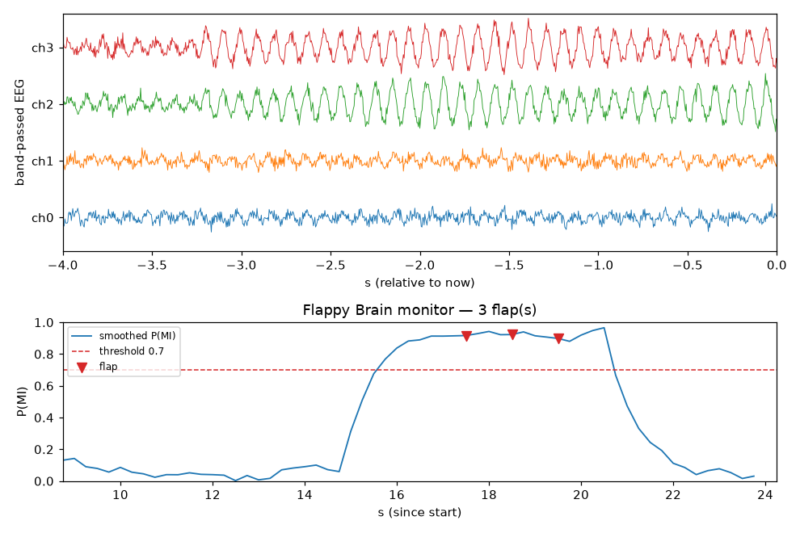
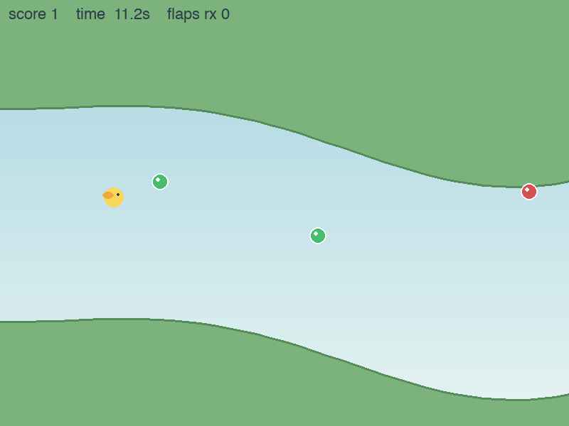

# flappy-brain-bci

Real-time motor-imagery EEG controller for the ISRC CN3 Hackathon 2026
"Flappy Brain" game: EEG streams in over LabStreamingLayer (LSL), a
CSP + LDA classifier detects the imagery, and flap commands go out to the
game over UDP. Includes a simulated EEG source and a pygame mock game, so
the whole loop runs on macOS/Linux with zero hardware.

[](https://github.com/aifriend/flappy-brain-bci/actions/workflows/test.yml)
[](LICENSE)

## Features

- **LSL input** — resolves any stream of type `EEG` (name/`--any-host`
  filters), background reader thread into a timestamped ring buffer;
  channel count and sampling rate discovered at runtime.
- **Classifier** — CSP (m=2) + LDA, numpy/scipy-only CSP implementation;
  optional **filter-bank CSP** (4–8 / 8–13 / 13–30 Hz, 12 features).
- **Two MI schemes** — `leftright` (LEFT vs RIGHT hand imagery, RIGHT = flap)
  and `feetrest` (REST vs both-feet imagery, FEET = flap); pick per
  participant (see *Calibration schemes*).
- **Calibration tool** — terminal-cued recording with configurable
  trials/cue/gap/epoch window, saves epochs + scheme metadata to `.npz`.
- **Live monitor dashboard** — scrolling band-passed EEG, smoothed flap-class
  probability with threshold line, flap markers, running flap count.
- **Mock game** — pygame Flappy-Bird clone speaking the same UDP protocol as
  the Unity game (mirrors its settings: flap force, gravity, time limit,
  spawn interval/jitter, seed).
- **Simulated EEG source** — fake LSL outlet with lateralized ERD, cue-driven
  or scripted, for headset-free development.
- **sklearn-free deployment** — models export to `.npz` arrays; inference
  needs only numpy + scipy (no pickle, no scikit-learn).
- **Session logging** — per-window CSV logs (probability, smoothed
  probability, flap flag) for post-hoc tuning and retraining.
- **Tested** — 30 tests including a full simulated LSL→classifier→UDP
  end-to-end run.

## Repository layout

```
flappy_brain/           the package
  lsl_input.py          resolve EEG stream, reader thread -> 4 s ring buffer (LSL timestamps)
  preprocessing.py      butterworth band-pass (SOS), optional notch
  csp.py                CSP + BandCSP (filter-bank), numpy/scipy only (importable for unpickling)
  model.py              Pipeline(BandCSP, LDA), CV + out-of-fold report, pickle, arrays export
  inference.py          numpy/scipy-only inference from exported .npz (no sklearn)
  calibration.py        cued LEFT/RIGHT or REST/FEET recording -> data/calib_*.npz
  online.py             sliding-window inference, smoothing, threshold + refractory, SessionLogger
  monitor.py            live dashboard (MonitorState data logic + LiveMonitor figure)
  output_udp.py         UDP flap sender ("1" to host:port)
  simulate.py           fake LSL EEG outlet; ch2/3 left motor, ch4 Cz, ch5/6 right motor
scripts/
  calibrate.py          record a cued calibration session (--scheme, --simulate)
  train.py              train + evaluate + export model
  play.py               live loop: LSL -> classifier -> UDP flaps (--monitor, --arrays, --log)
  mock_game.py          pygame demo game speaking the game's UDP protocol
tests/                  unit tests + simulated end-to-end test
docs/                   screenshots (dashboard, mock game)
data/                   calibration .npz + session logs (gitignored)
```

## Installation

Requires Python 3.10+.

```bash
python3 -m venv .venv
.venv/bin/pip install -r requirements.txt
```

Dependencies: numpy, scipy, scikit-learn, pylsl, matplotlib, pygame-ce,
pytest. Notes:

- `pylsl` ships prebuilt wheels (bundled liblsl) for macOS/Linux/Windows.
- We depend on **`pygame-ce`** (drop-in `pygame` replacement, prebuilt
  manylinux/macOS wheels with bundled SDL) because stock pygame 2.6.1's font
  module is broken on Python 3.14.

## Quickstart (zero hardware)

Train a model on the built-in simulator first (`model.pkl` is gitignored —
everyone trains their own):

```bash
.venv/bin/python scripts/calibrate.py --simulate --trials 10
.venv/bin/python scripts/train.py --data data/calib_<timestamp>.npz
```

Then two terminals — start the game first so no flap packets are missed:

```bash
# terminal 1 — the mock game
.venv/bin/python scripts/mock_game.py

# terminal 2 — the BCI pipeline with live dashboard
.venv/bin/python scripts/play.py --simulate --monitor
```

The simulator cycles rest → LEFT → rest → RIGHT (4 s each); flaps should
arrive only during RIGHT phases and the bird should flap in the game window.
Use `--scheme feetrest` on all three commands for the REST/FEET variant
(cycle rest → FEET).

## Game-day runbook (Windows PC + NeuroCONCISE)

1. Windows PC: .NET 5.0 runtime installed; start the game (`ISRC CN3 2026.exe`)
   and the NeuroCONCISE software; confirm the EEG stream is on LSL (type `EEG`).
2. This machine (same LAN), in order:
   `calibrate.py` → `train.py` (check flap-class recall ≥ 0.8; if lower, redo
   with `--trials 30` or try `--filterbank`) → `play.py --host <game-pc-ip>
   --monitor` (optionally `--arrays model_arrays.npz` if sklearn is a problem
   on that machine).
3. Tune live with flags on `play.py`:
   - `--threshold` (default 0.7): lower if flaps are missed (recall!), raise on false flaps.
   - `--refractory` (default 1.0): min seconds between flaps.
   - `--smoothing` (default 0.3): lower = more responsive, higher = steadier.
   - `--window` / `--step` (default 1.0 / 0.25 s).
4. After each run, check the session CSV in `data/` to see where the
   flap-class probability sat relative to the threshold.
5. Ctrl-C stops `play.py` cleanly and prints windows classified / flaps sent.

### Fallback: LSL output instead of UDP

If the organizers prefer LSL input to the game, swap `output_udp.py` for a
small LSL outlet: stream name `MotorImagery`, type `Markers`, 1 float32
channel, irregular rate; push `1.0` = flap, `0.0` = idle. That is the only
module that changes.

## Calibration schemes

Two class schemes, label 1 = flap class in both:

- `leftright` (default): LEFT (0) vs RIGHT (1) hand imagery; RIGHT = flap.
- `feetrest`: REST (0) vs both-FEET (1) imagery; FEET = flap.

`calibrate.py --scheme` selects the cues and stores the scheme in the `.npz`
metadata; `train.py` picks it up (confusion-matrix labels, model metadata);
`play.py --scheme` selects the scripted simulator cycle and warns if the
model was trained for another scheme.

### Game-day scheme screening (pick what works for the pilot)

Record a quick session per scheme, train both, compare:

```bash
.venv/bin/python scripts/calibrate.py --scheme leftright --trials 10
.venv/bin/python scripts/train.py --data data/calib_<t1>.npz --out model_lr.pkl
.venv/bin/python scripts/calibrate.py --scheme feetrest --trials 10
.venv/bin/python scripts/train.py --data data/calib_<t2>.npz --out model_fr.pkl
```

Compare the out-of-fold confusion matrices and flap-class (RIGHT/FEET)
recall; play with the winner. ~10 trials/class per scheme takes about two
minutes per scheme and is usually enough to see which one separates.

### train.py output (simulated calibration data)

```
[train] 5-fold CV accuracy: 1.00 1.00 1.00 1.00 1.00  (mean 1.000 +/- 0.000)
[train] out-of-fold confusion matrix (rows=true, cols=pred):
[train]           pred  LEFT RIGHT
[train]   true  LEFT       8       0
[train]   true RIGHT       0       8
[train] per-class metrics (out-of-fold): precision/recall/f1 per class ...
[train] hint: a missed RIGHT = a fallen bird — if RIGHT recall is low, lower
       --threshold in play.py toward recall ...
```

The recall numbers are out-of-fold (`cross_val_predict`, same folds as the
accuracy) — tune `--threshold` toward flap-class recall, not raw accuracy.

## Live monitor

`play.py --monitor` opens a live dashboard that updates with every window step
(~4 Hz): the last 4 s of band-passed EEG for the first channels
(`--monitor-channels N`, default 4), the smoothed flap-class probability over
the last 15 s with the flap threshold as a dashed line, flap events as red
markers, and a running flap count in the title.



Notes:

- The matplotlib window must run on the main thread — it does, since the
  online loop drives redraws itself; don't run `play.py` backgrounded.
- Closing the dashboard window **stops the loop** (same as Ctrl-C) — the
  classifier is not meant to run unwatched on game day.
- Headless runs (e.g. `MPLBACKEND=Agg`) work fine: no window is shown and the
  loop just runs without rendering.

## Mock game

`scripts/mock_game.py` is a pygame Flappy-Bird clone that listens for the same
UDP flap packets (`"1"` on `127.0.0.1:5005`) as the real Unity game — the
classifier can fly a bird without Windows. Green neurons = +1, red
neurons = −1, hilly terrain kills on contact (auto-restart). Settings mirror
the Unity game (`--flap-force`, `--gravity`, `--time-limit`,
`--spawn-interval`, `--spawn-jitter`, `--seed`).



Useful flags: `--auto` (built-in autopilot, no EEG needed), `--seed N`
(reproducible neuron layouts), `--duration S`, and `--frames-dir DIR` for
headless rendering checks (`SDL_VIDEODRIVER=dummy`). Manual controls:
SPACE = flap, R = restart, ESC = quit.

## Deployment without sklearn

`train.py` always exports `model_arrays.npz` alongside the pickle (`--export
PATH` to override): CSP filters per band, LDA coef/intercept, fs, band edges,
scheme, layout version. `play.py --arrays model_arrays.npz` runs the
identical classifier with only numpy+scipy (flap probability = sigmoid of the
LDA score, exactly matching sklearn's binary `predict_proba`) — handy if the
machine next to the game can't install scikit-learn, and safer than
unpickling.

`train.py --filterbank` uses bands (4–8, 8–13, 13–30) Hz with a separate CSP
per band (12 features) instead of the default single 8–30 Hz band. Bands are
stored inside the pickle and in the exported npz, so `play.py` picks them up
automatically on both paths (`--filterbank` on play.py is only a consistency
check).

Session logs: every play session writes `data/session_<timestamp>.csv`
(`--log PATH` to override, `--no-log` to disable): a `#`-prefixed header with
model/threshold/refractory/smoothing/window/step, then one row per classified
window: `t_rel,p_right,p_smooth,flapped`. Use it for post-hoc threshold
tuning and as extra (labeled-by-behavior) data for retraining.

## Testing

```bash
MPLBACKEND=Agg SDL_VIDEODRIVER=dummy .venv/bin/python -m pytest tests/ -q
```

30 tests: CSP, preprocessing, filter-bank, arrays-export equivalence, session
logging, monitor data logic, mock-game mechanics, scheme handling, and a full
simulated end-to-end test (simulated LSL stream → calibration → training →
online loop → UDP flaps at a listener, flaps asserted inside the scripted
imagery phases). CI runs the same command on ubuntu-latest (see
`.github/workflows/test.yml`).

## License

MIT — see [LICENSE](LICENSE).
